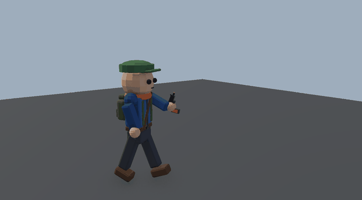

# 主角风格提案 v1（待评估）

> 状态：**风格探索，未定稿**。游戏逻辑尚未开发；本模型只用于评估美术方向。
> 生成方式：Blender 5.2 headless 脚本程序化建模（纯程序化、无外部素材），导出 FBX 进 Unity。

## 1. 风格方向

**低多边形 Q 版 + 纯色卡通**（Low-poly Chibi, flat color, 无贴图）

- 约 3.5 头身，大头短身，俯视角也能看出是"人"。
- 平面着色（flat shading）+ URP Lit 纯色材质，无纹理、无法线细节。
- 配色克制，用橙色围巾做视觉锚点；整体是"末日拾荒者"气质，不是科幻士兵。

## 2. 角色设定

| 部位 | 设定 | 颜色 |
|---|---|---|
| 帽子 | 橄榄绿棒球帽（帽檐朝前） | `#3D663D` |
| 头 | Q 版大头，黑点眼睛 + 短嘴线 | 肤色 `#DBAA80` |
| 围巾 | 橙色围巾（视觉焦点） | `#DB5724` |
| 上衣 | 蓝色牛仔夹克（袖口略深） | `#26578F` / `#1C4275` |
| 胸前 | 棕色斜挎带 + 双背包带 | `#54361F` / `#4A5430` |
| 背包 | 军绿背包 + 侧袋 | `#4A5430` |
| 下装 | 深灰工装裤 + 棕色腰带/靴子 | `#33353D` / `#54361F` |
| 武器 | 深色手枪（右手，朝前） | `#1C1C21` |

## 3. 交付物

| 内容 | 路径 |
|---|---|
| Blender 生成脚本（可复现/可改） | [ArtSource/PlayerPreview.py](../ArtSource/PlayerPreview.py) |
| 模型 FBX（1.8m 高，~2000 tris，33 部件，10 种材质） | [Assets/Models/PlayerPreview.fbx](../ZombieAutoShooter/Assets/Models/PlayerPreview.fbx) |
| 可直接使用的 Prefab（URP 材质已配好） | [Assets/Prefabs/PlayerPreview.prefab](../ZombieAutoShooter/Assets/Prefabs/PlayerPreview.prefab) |
| 预览场景（角色 + 4 机位 + 地面贴图环境） | [Assets/Scenes/StylePreview.unity](../ZombieAutoShooter/Assets/Scenes/StylePreview.unity) |
| 截图：3/4 英雄视角 / 正面 / 侧面 / 游戏俯视角 | `ZombieAutoShooter/Assets/Screenshots/style_*.png` |
| 材质（URP Lit 纯色，可调） | `ZombieAutoShooter/Assets/Materials/StylePreview/` |

打开方式：Unity 里打开 `Assets/Scenes/StylePreview.unity`，或把 `Assets/Prefabs/PlayerPreview.prefab` 拖进任意场景。

## 4. 动画（预览级，已实现）



- **程序化动画**（无骨骼）：`Assets/Scripts/Preview/PlayerPreviewAnimator.cs`
  - 环绕走位、自动朝向前进方向；
  - 左右腿交替摆动、左臂反向摆动、右臂持枪前举瞄准；
  - 身体随步频上下起伏（bob）。
- 关节枢轴在运行时自动生成（脚→腿、手/枪→臂），所以**Prefab 不需要额外绑定**，直接挂脚本就能动。
- 帧录制：`Assets/Scripts/Preview/PreviewFrameRecorder.cs`（Play Mode 里按 12fps 截图到 `Temp/anim_capture`，不进 Assets），GIF 由外部 Pillow 合成。
- 说明：这是**姿态级摆动**的占位动画，关节处可能有轻微穿插，不能替代正式骨骼动画。

### 4.1 武器挂载（2026-11-24 改动）

- 玩家模型**不再内置手枪**，开局两手空空。
- 右手 `Hand_R` 下新增空物体 `WeaponSocket`（位置在掌心，局部旋转与角色根一致）。
- 游戏开始时把武器 Prefab 挂到 socket：

```csharp
var gun = Instantiate(weaponPrefab);
gun.transform.SetParent(socket, true);        // 保持世界旋转（Prefab 自带 FBX 轴转换）
gun.transform.localPosition = Vector3.zero;   // 握把对齐掌心
```

- 枪口朝角色 +Z 前方；换武器 = 销毁旧枪、把新枪挂到同一 socket，不影响动画和逻辑脚本。
- **朝向约束**：举臂瞄准时手臂会绕 X 轴旋转，如果枪完全跟随手臂，枪口会朝上。所以预览动画里在 `LateUpdate` 把枪的世界朝向锁到「身体朝向 × -90°X」（枪口水平朝前），位置仍跟随手掌；正式游戏里这层由瞄准逻辑控制。
- 实现注意：`Hand_R` 在 `Awake` 里会被挂到手臂枢轴 `pivotArmR` 下，**此时手臂已经不在模型根节点层级里**，所以查找 `WeaponSocket` / 武器必须从 `AnimRoot`（wrapper）往下找，否则拿不到引用，枪会继续跟着手臂抬起。
- Play 模式实测：枪口方向与身体前方夹角 **0.0°**，枪的位置与手部位置重合（验证截图 `ZombieAutoShooter/Assets/Screenshots/aim_check.png`，动画 GIF `Docs/anim_preview.gif`）。
- 预览场景里已经示范：`Assets/Scenes/ArtReview.unity` 与 `StylePreview.unity` 中玩家的手枪就是通过 socket 挂上去的 `Pistol_Equipped`。

## 5. 已知限制- 无骨骼、无蒙皮；目前动画是部件级的（见 §4），正式化时可选方案：
  1. 在 Blender 里加骨架，导出 idle / walk / shoot 三个 clip（质量最高，工作量大）；
  2. 继续用程序化动画驱动（成本低，占位完全够用）；
  3. 玩家不做走路循环，只做"上下浮动 + 朝向"（最省，但动感最弱）。
- 无贴图、无描边（若想要"卡通描边"风格需要 URP 自定义 Renderer Feature，属于后续可选项）。
- 部件是独立对象（未合并网格），便于按材质替换/改色；性能上 33 个 renderer 对小场景无压力，正式化时可合并。

## 6. 需要你评估的问题

1. **方向**：低多边形 + 纯色卡通这个方向是否符合你想要的风格？
2. **比例**：头身比（现在约 3.5 头身）要不要更 Q（头更大）或更写实（5–6 头身）？
3. **配色**：蓝夹克 + 橄榄帽 + 橙围巾这套配色 OK 吗？要不要更暗黑/更鲜艳？
4. **细节**：现在细节程度（挎带、背包袋、枪）够不够？要不要加护膝/手套/面罩等末日元素？
5. **相机**：按提示词 60° 俯角、距离 12 米，1.8m 角色只占屏高约 13%（约 100px，见 `style_game.png`）。要不要把相机拉近到 9–10 米，或把角色放大到 2.2m 左右，让主角在战斗中更醒目？

## 7. 与提示词的关系

- 提示词原定"全部基础几何体占位"；本模型是**风格预览**，你确认后：
  - 玩家外观替换为 `PlayerPreview`（或按你意见迭代 v2）；
  - 僵尸 / 远程僵尸 / Boss 仍先用几何体占位，随后按同一风格做低多边形版本；
  - 换外观只改 Prefab 的 `VisualRoot`，不影响逻辑脚本。
- 未确认前不把模型接入游戏逻辑。
